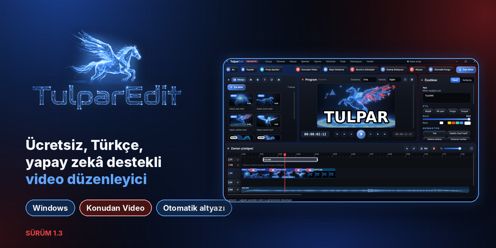
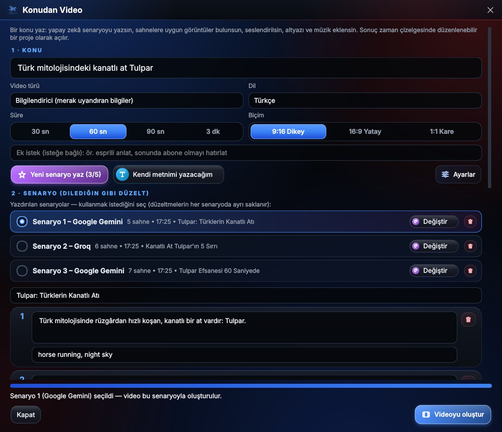
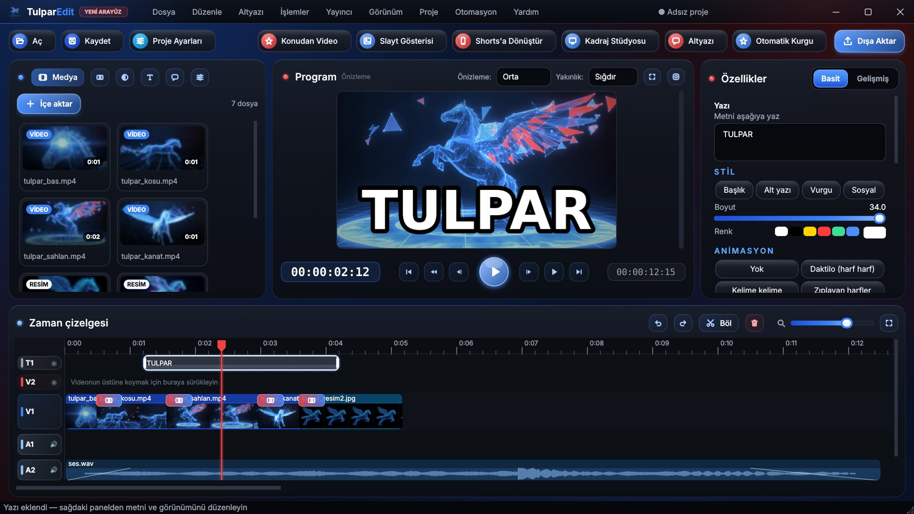
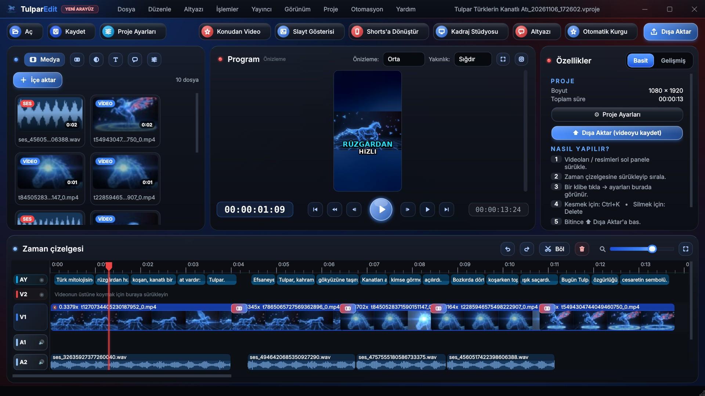
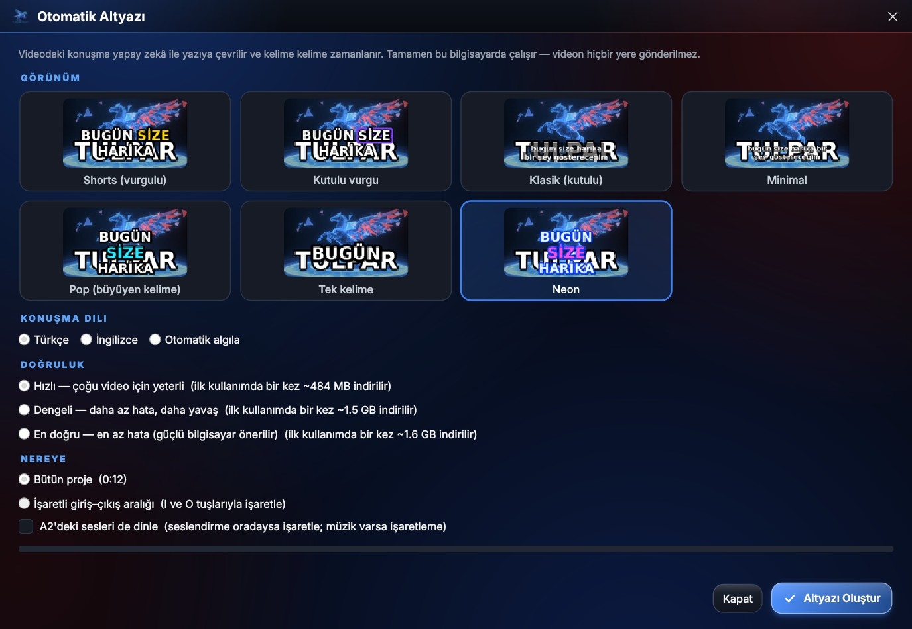
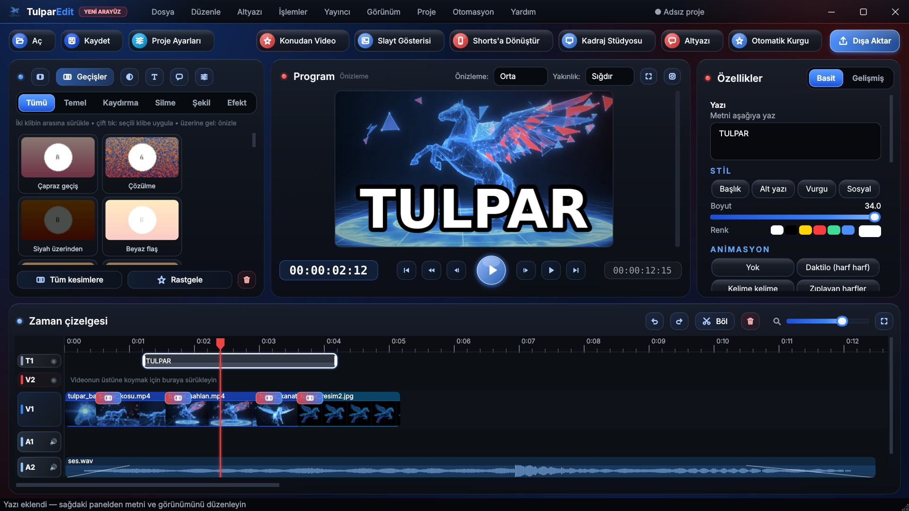
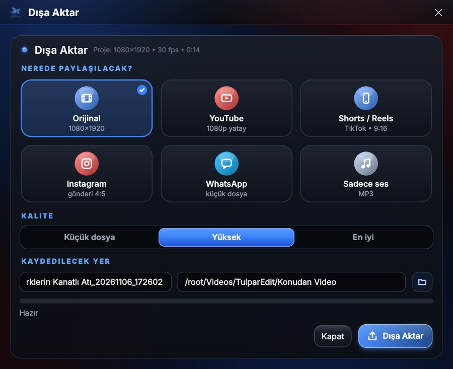
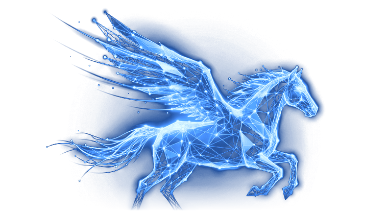

  

<h3 align="center">Ücretsiz, Türkçe ve yapay zekâ destekli video düzenleme programı (Windows)</h3>

  <a href="https://github.com/hakkiodbs/TulparEdit/releases/latest/download/TulparEdit_Kurulum.exe"><b>⬇ Ücretsiz indir</b></a>
  &nbsp;·&nbsp;
  <a href="https://hakkiodbs.github.io/TulparEdit/"><b>🌐 Tanıtım sayfası</b></a>
  &nbsp;·&nbsp;
  <a href="https://github.com/hakkiodbs/TulparEdit/releases">📝 Sürüm notları</a>

  
  
  
  

---

## ✨ Yeni: Konudan Video (1.3)

Bir konu yaz, gerisini TulparEdit yapsın:

1. **Konuyu yaz:** "Kapadokya hakkında çoğu kişinin bilmediği 5 şey" gibi. Süreyi ve biçimi (9:16, 16:9, 1:1) seç.
2. **Senaryoyu seç:** Yapay zekâ en fazla 5 farklı senaryo yazar. Beğendiğini seçer, istediğin cümleyi düzeltirsin.
3. **Gerisi otomatik:** Sahnelere uygun görüntüler (Pexels / Pixabay), doğal Türkçe seslendirme, kelime kelime altyazı ve fon müziği.
4. **Düzenle ve paylaş:** Sonuç zaman çizelgesinde düzenlenebilir proje olarak açılır. Dışa aktar, doğrudan YouTube'a yükle.

Ücretsiz yapay zekâ servisleri: **Google Gemini**, **Groq**, **OpenRouter** (biri cevap vermezse sıradaki denenir).

## 🎬 Neler yapabilir?

| | |
|---|---|
| **Zaman çizelgesi** | Sınırsız video, ses ve yazı izi. Kes, böl, taşı, üst üste koy. |
| **Otomatik altyazı** | Konuşmayı yazıya çevirir; Shorts, Pop, Neon gibi kelime kelime vurgulu stiller. |
| **Shorts / Reels / TikTok** | Yatay videoyu dikeye çevir, Kadraj Stüdyosu, Shorts paketi. |
| **Geçiş ve filtreler** | Geçişler, renk ayarları, LUT, hız eğrileri, arka plan silme, yeşil perde, maske. |
| **Ses** | Gürültü azaltma, konuşma / müzik ayırma, mikrofonla kayıt, doğal Türkçe seslendirme. |
| **Otomatik Kurgu** | Sessiz yerleri keser, sesi düzeltir, altyazıyı ekler. |
| **Dışa aktar ve yayınla** | YouTube, Shorts, Instagram, WhatsApp için hazır ayarlar; YouTube'a doğrudan yükleme. |
| **Marka** | Logo, filigran ve reklam ekleme. |
| **Otomasyon** | Botlar ve yapay zekâ araçları için API ve MCP desteği. |

## 🖼 Ekran görüntüleri

<table>
<tr>
<td>
Konudan Video ile oluşan proje
</td>
<td>
Otomatik altyazı
</td>
</tr>
<tr>
<td>
Geçişler
</td>
<td>
Dışa aktar
</td>
</tr>
</table>

## ⬇ Kurulum

1. **[TulparEdit_Kurulum.exe](https://github.com/hakkiodbs/TulparEdit/releases/latest/download/TulparEdit_Kurulum.exe)** dosyasını indir.
2. Çift tıklayıp aç ve adımları izle. Yönetici izni gerekmez.
3. Windows "Bilgisayarınız korundu" uyarısı gösterirse **Ek bilgi → Yine de çalıştır** seç.

**Gereken:** Windows 10 veya 11 (64 bit).

## 🔄 Güncellemeler

Yeni sürüm çıktığında program kendisi haber verir; **"Şimdi güncelle"** ile tek tıkla güncellenir.
Elle denetlemek için: **Yardım → Güncellemeleri denetle**.

## 🐞 Sorun bildirme

Bir hata görürsen **[Issues](https://github.com/hakkiodbs/TulparEdit/issues)** sayfasından yazabilirsin.
Hata kaydını eklemek için programda **Yardım → Hata kaydını aç** (dosyayı mesaja ekle).

---

   
  Hakkı Odabaş · <a href="https://www.youtube.com/@Hakkiodabas">YouTube</a> · <a href="https://hakkiodbs.github.io/">hakkiodbs.github.io</a>

