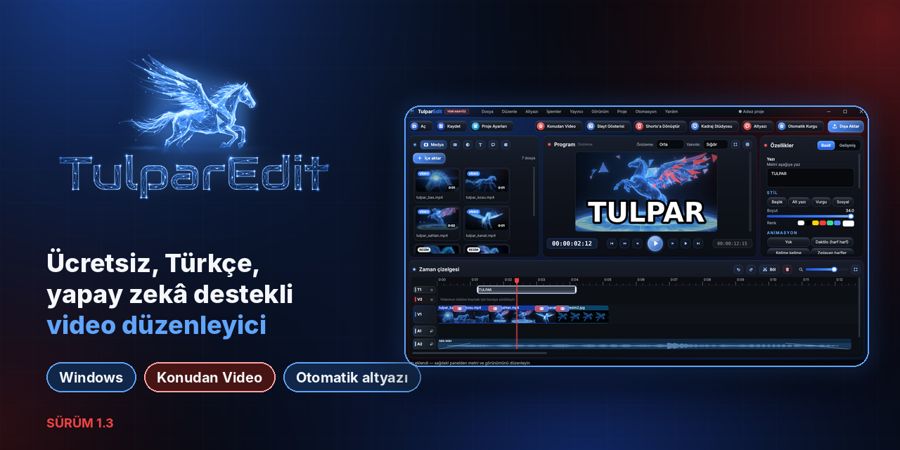
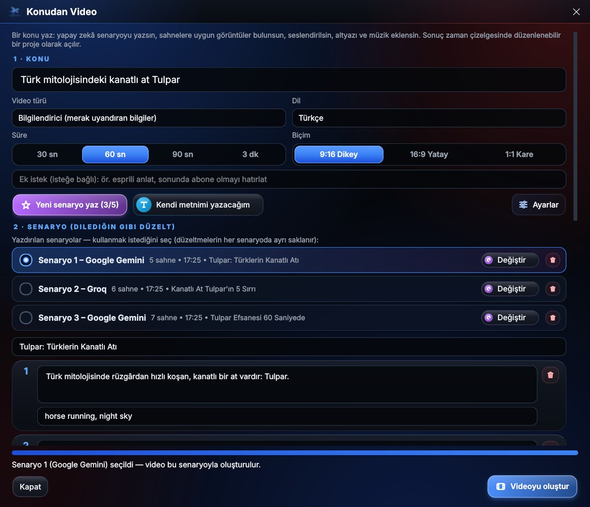
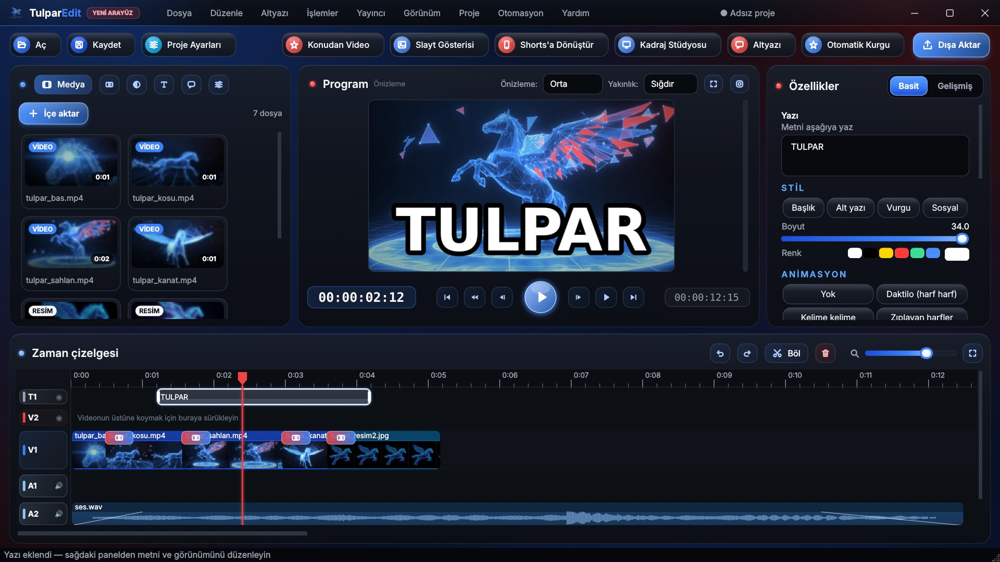
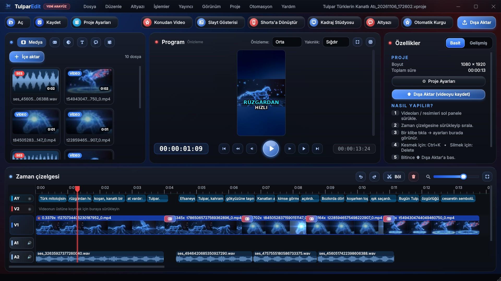
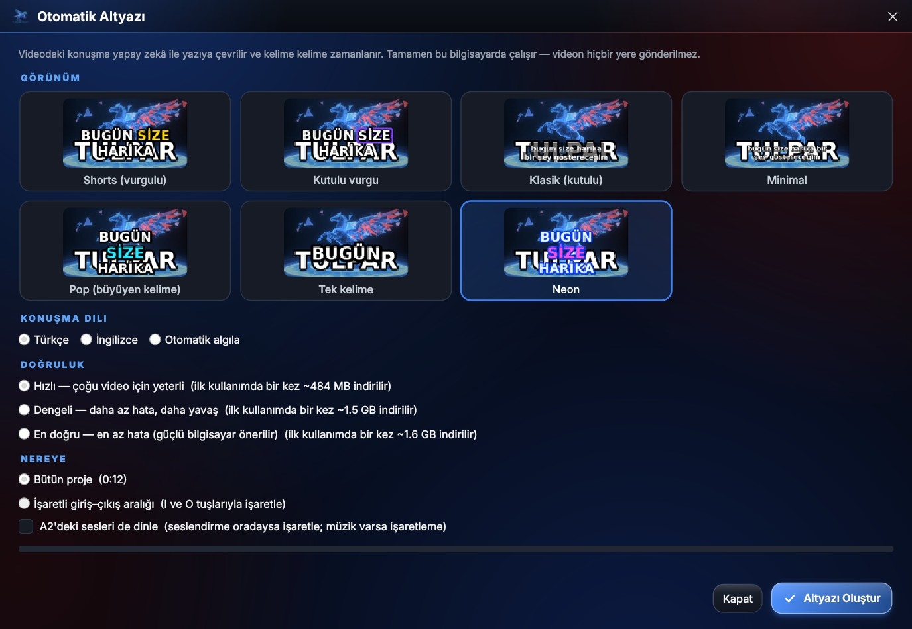
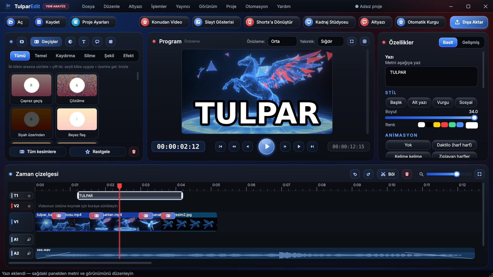
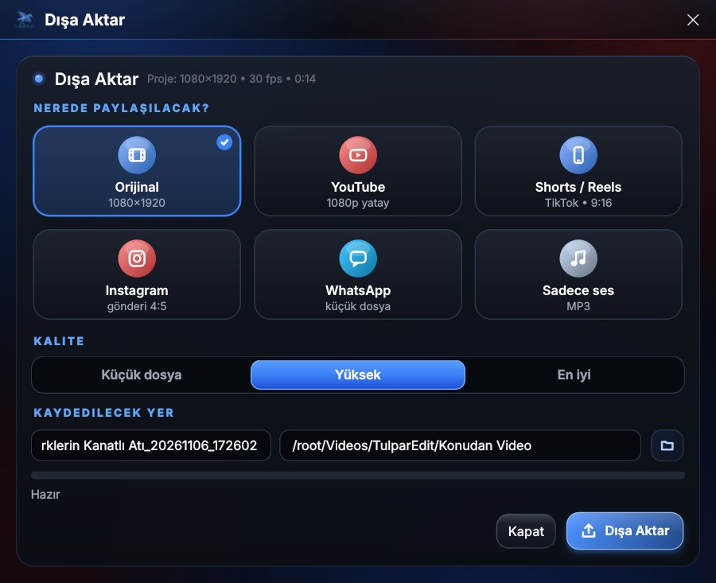

  <a href="README.md">🇹🇷 Türkçe</a> &nbsp;·&nbsp; <b>🇬🇧 English</b>

  

<h3 align="center">Free, AI-powered video editing software for Windows</h3>

  <a href="https://github.com/hakkiodbs/TulparEdit/releases/latest/download/TulparEdit_Kurulum.exe"><b>Download for Windows</b></a>
  &nbsp;·&nbsp;
  <a href="https://hakkiodbs.github.io/TulparEdit/?lang=en"><b>🌐 Website & Demo</b></a>
  &nbsp;·&nbsp;
  <a href="https://github.com/hakkiodbs/TulparEdit/releases">📝 Release Notes</a>

  
  
  
  

---

## ✨ New: Topic to Video (v1.3)

Just enter a topic or prompt, and TulparEdit takes care of the rest:

1. **Enter your topic:** E.g., *"5 hidden facts most people don't know about Cappadocia"*. Choose the duration and format (9:16 vertical, 16:9 landscape, 1:1 square).
2. **Select a script:** AI writes up to 5 unique creative scripts. Choose your favorite and edit any sentence as you like.
3. **Automated generation:** Matches scene b-roll visuals (Pexels / Pixabay), natural voiceover synthesis, word-by-word animated subtitles, and background music automatically.
4. **Edit and publish:** The result opens in the timeline as a fully editable multi-track project. Customize scenes, export, or upload directly to YouTube.

Supported free AI services: **Google Gemini**, **Groq**, **OpenRouter** (with automatic fallback to the next provider if one fails).

## 🎬 What Can It Do?

| Feature | Description |
|---|---|
| **Multi-Track Timeline** | Unlimited video, audio, and text tracks. Cut, split, ripple edit, overlay, and snap to magnetic grid. |
| **Auto Subtitles & Captions** | Accurate speech-to-text with word-by-word highlighted styles like Shorts, Pop, Neon, and more. |
| **Shorts / Reels / TikTok** | Instant landscape-to-portrait conversion, Framing Studio with face/subject tracking, one-click Shorts presets. |
| **Transitions & Video Filters** | Rich transition library, color grading, 3D LUT support, speed ramping curves, background removal, chroma key / green screen, and masking. |
| **Audio Studio** | AI noise reduction, vocal and background music separation, voice recorder, and natural TTS voiceover. |
| **Auto Smart Edit** | Automatically cuts dead silences, levels audio, and adds subtitles — edit long videos in minutes. |
| **Export & Direct Publishing** | Optimized presets for YouTube, Shorts, Instagram, WhatsApp; direct one-click YouTube upload. |
| **Branding & Watermarks** | Easily insert logos, custom watermarks, and intro/outro sequences. |
| **Automation & MCP** | Native API and Model Context Protocol (MCP) support for AI agents, external bots, and automated pipelines. |

## 🖼 Screenshots

<table>
<tr>
<td>
Project generated with Topic to Video
</td>
<td>
Dynamic Auto Subtitles
</td>
</tr>
<tr>
<td>
Transitions Library
</td>
<td>
Export & Presets
</td>
</tr>
</table>

## ⬇ Installation

1. Download the **[TulparEdit Setup Installer](https://github.com/hakkiodbs/TulparEdit/releases/latest/download/TulparEdit_Kurulum.exe)** (`TulparEdit_Kurulum.exe`).
2. Double-click the installer and follow the setup wizard. **No administrator permissions required.**
3. If Windows Defender SmartScreen shows *"Windows protected your PC"*, click **More info → Run anyway**.

**System Requirements:** Windows 10 or 11 (64-bit).

## 🔄 Updates

TulparEdit automatically checks for updates on launch. When an update is released, you can update seamlessly in one click via **"Update Now"**.
To check manually: Go to **Help → Check for Updates**.

## 🐞 Bug Reports & Feedback

Found a bug or have a suggestion? Feel free to open an issue on the **[Issues](https://github.com/hakkiodbs/TulparEdit/issues)** page.
To attach logs: inside the app, go to **Help → Open Log File** and attach the file to your issue.

---

   
  Hakkı Odabaş · <a href="https://www.youtube.com/@Hakkiodabas">YouTube</a> · <a href="https://hakkiodbs.github.io/">hakkiodbs.github.io</a>

